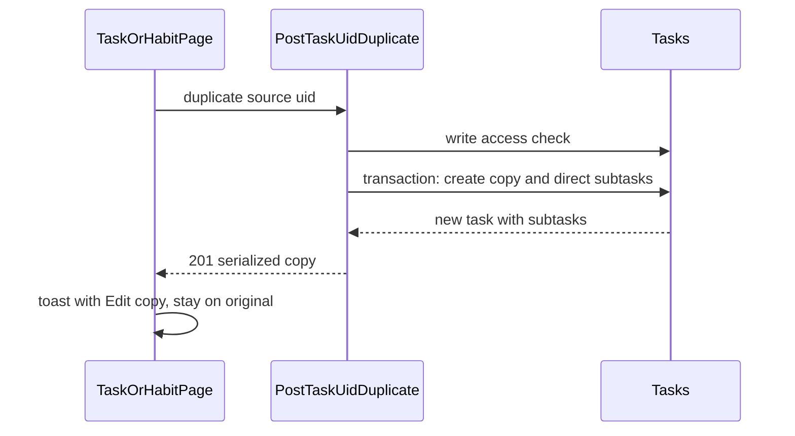

# Duplicate task: implementation plan

## Summary

Add a server-side duplicate action that creates a separate, not-started copy of a task (and its direct subtasks). Expose it from the task page and the habit page. After success, the user stays on the original and gets a toast with an **Edit copy** action that opens the new item and focuses its title.

## Confirmed behavior

- Duplicating creates a new task owned by the current user. The original is not modified.
- The copy keeps the stored title (no "copy" suffix), description, project, area, tags, and priority.
- Habit setup is copied (`habit_mode`, target count, frequency, streak mode, flexibility). Current streak, best streak, total completions, and last completion are reset.
- The copy always starts as **not started**, with `completed_at` cleared.
- Due date, reminder, and defer-until are left empty.
- Recurrence is `none`, with no link to the original series or its instances.
- Assignee, involved people, attachments, activity events, and AI insights are not copied.
- Direct subtasks are copied one level deep, in the same order, under the new parent, using the same rules. Grandchildren are not copied.
- A duplicated subtask becomes a sibling under the same parent, inserted immediately after the original. A top-level task stays top-level.
- Duplicate appears in the task page "..." menu, next to Delete, and as a button on the habit page, next to Delete. Lists, the board, and the calendar do not get a separate control.
- On success: stay on the original, show a success toast with **Edit copy**. That action opens `/task/:uid` (or `/habit/:uid` for habits) and focuses the title.
- On failure: stay on the original and show an error toast.

## Flow

## Implementation steps

1. **Duplicate operation.** Add `backend/modules/tasks/operations/duplicate.js`.
   - Load the source task with its tags and direct subtasks (and each subtask's tags) inside `sequelize.transaction`.
   - Build attributes from the stored row, not from a client payload. This keeps a recurring display name from overwriting the stored title.
   - Create the parent copy, then attach tags through the existing `updateTaskTags` in `backend/modules/tasks/operations/tags.js`.
   - Create each direct child the same way, with `parent_task_id` set to the new parent.
2. **Sibling ordering.** If the source has `parent_task_id` and a numeric `order`, set the copy's `order` to `order + 1` and shift later siblings. If `order` is null, append after the current maximum. Top-level copies leave `order` null.
3. **Route.** Add `POST /task/:uid/duplicate` in `backend/modules/tasks/routes.js`, guarded by `requireTaskWriteAccess`.
   - Reuse the project and area access checks from `POST /task`.
   - Return `201` with the serialized copy, using the same include (`TASK_INCLUDES_WITH_SUBTASKS`) and `serializeTask` path as create.
   - Document the route in `backend/docs/swagger/tasks.js`.
4. **Client service.** Add `duplicateTask(uid)` in `frontend/utils/tasksService.ts`, following `createTask` (CSRF headers, auth handling).
5. **Task page.**
   - Add a Duplicate item above Delete in `frontend/components/Task/TaskDetails/TaskDetailsHeader.tsx`.
   - Handle it in `frontend/components/Task/TaskDetails.tsx`: call the API, add the copy to `tasksStore` via `setTasks`, and show the success toast.
   - The toast's **Edit copy** navigates to the copy with `state: { focusTitle: true }`. Do not use `isNew: true`. That flag makes the page delete the task on leave if it was not modified.
   - Honor `focusTitle` through the existing `autoEditTitle` prop.
6. **Habit page.** Add a Duplicate button next to Delete in `frontend/components/Habits/HabitDetails.tsx`, with the same toast. **Edit copy** goes to `/habit/:uid` and calls the existing `setEditingField('name')` path when `focusTitle` is set. Do not treat the copy as an unsaved new habit (`uid === 'new'`).
7. **Tests.** Add integration tests to `backend/tests/integration/tasks.test.js` (or a sibling file if that file is too large):
   - The copy keeps title, note, project, area, tags, priority, and habit setup.
   - The copy is not started. Schedule, recurrence, series link, people, attachments, events, and AI insights are absent. Habit counters are zero.
   - The original row is unchanged and the copy has a different uid.
   - Subtasks are new, not-done rows under the new parent, in order. Grandchildren are not copied.
   - Duplicating a subtask inserts a sibling just after it.
   - Missing task returns 404. No write access returns 403.

## Affected areas

- Backend: `backend/modules/tasks/routes.js`, new `backend/modules/tasks/operations/duplicate.js`, `backend/modules/tasks/operations/tags.js` (reused), `backend/docs/swagger/tasks.js`.
- Frontend: `frontend/utils/tasksService.ts`, `frontend/components/Task/TaskDetails/TaskDetailsHeader.tsx`, `frontend/components/Task/TaskDetails.tsx`, `frontend/components/Habits/HabitDetails.tsx`.
- Unchanged: list, board, and calendar views (they already open the task or habit page).

## Risks

- Reusing the `isNew` flag would delete the copy if the user leaves without editing. The plan uses `focusTitle` only.
- Success toasts dismiss after 4 seconds (`frontend/components/Shared/ToastContext.tsx`), so **Edit copy** is clickable only during that window.
- Tags are reattached by name for the current user. On a shared task whose tags belong to someone else, this can create same-named tags for the duplicating user.
- Project or area validation can reject a duplicate even though the source still shows that project or area.
- Only one checklist level is copied. A subtask that has its own children would lose those descendants in the copy.
- Sibling order is meaningful only when `order` is set. Null orders append at the end.
- Task create does not push CalDAV, so this action adds no sync step.

## Assumptions

- The confirmed product rules above apply.
- Write access on the source is required. The copy's `user_id` is the current user.
- The stored task name is copied as-is.
- The parent and its subtasks commit or roll back together.
- After implementation, verify in the browser: duplicate from a task page and a habit page, confirm the original remains, open **Edit copy**, confirm the title is focused, and confirm the copy is not deleted on leave.

## Todos

- [x] `duplicate-operation`: transactional duplicate operation that copies the confirmed fields and direct subtasks, and resets schedule, status, recurrence, people, and habit progress.
- [x] `duplicate-route`: `POST /task/:uid/duplicate` with write access, serialized 201 response, and swagger.
- [x] `duplicate-ui`: Duplicate on the task overflow menu and habit page, with a stay-put toast whose **Edit copy** opens the new item and focuses the title via `focusTitle`.
- [x] `duplicate-tests`: cover field copy, resets, original unchanged, subtask sibling order, and auth failures.
